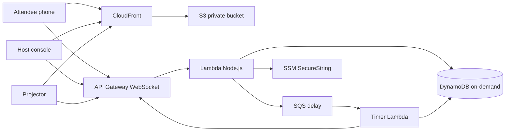

# Builders Live

[](https://polyformproject.org/licenses/noncommercial/1.0.0)
[](https://creativecommons.org/licenses/by-nc/4.0/)
[](https://aws.amazon.com/about-aws/global-infrastructure/regions_az/)

Builders Live is a live multiplayer web app for a room full of people. Everyone joins from a phone or laptop. A projector shows the same room as it changes.

It was built for an AWS Student Builder Group meetup. Other community organizers can reuse it for their own non-commercial events.

Source-available, and open for non-commercial use. Commercial use is not permitted.

## What it is

Nothing to install and no account. The host screen shows a QR code and a short room code. An attendee opens the link, types a display name, and they are in. The backend issues a signed session token scoped to that room. Names and questions pass a light profanity filter. If the venue Wi-Fi drops, the phone reconnects on its own and the server restores the score and the team.

Attendee features, in the order they appear:

1. **Team Battle.** People are split across teams. The host runs timed multiple-choice rounds. Faster correct answers score more. The wall updates as answers land.
2. **Build Board.** One shared canvas. People drag AWS service tiles and connect them, with live cursors. The host can set a challenge, lock the board, or clear it.
3. **Live Q&A.** People post questions and upvote. The top of the list rises live. The host can mark a question answered or hide it.
4. **Builder Match.** People tick interests and get matched with 2 or 3 others in the room.

## License

Free to use and modify for non-commercial meetups, community events, and learning. Commercial use is not permitted.

| What | License |
| --- | --- |
| Code | [PolyForm Noncommercial License 1.0.0](https://polyformproject.org/licenses/noncommercial/1.0.0) (`LICENSE`) |
| Event content, docs, and images | [CC BY-NC 4.0](https://creativecommons.org/licenses/by-nc/4.0/legalcode) (`LICENSE-CONTENT`, `content/LICENSE`, `docs/LICENSE`) |

Licensor: Ram Surya Chelluboyina.

Required Notice: Copyright Ram Surya Chelluboyina (https://github.com/RamSuryaCH)

For anything else, contact Surya through GitHub: https://github.com/RamSuryaCH

## Run it at your meetup

From a clone of this repo in **AWS CloudShell** (nothing to install on a laptop):

```bash
bash deploy/cloudshell-deploy.sh
```

The script asks for two things that are not in the repo:

- a host PIN (the admin secret)
- an email address for the 5 USD budget alert

It deploys only in `ap-southeast-2`, builds the site, and prints the CloudFront URL. Open `/host` on that URL, enter the PIN, and create a room.

AWS emails the budget address to confirm the alert. The alarm fires at 5 USD of monthly cost.

To remove everything:

```bash
bash deploy/cloudshell-destroy.sh
```

Details are in [docs/teardown.md](docs/teardown.md).

## How attendees join

1. The projector (`/screen/<CODE>`) shows a QR code and the room code while teams fill.
2. The phone opens `/join/<CODE>`.
3. They type a display name and tap **I'm in**.
4. They land in the room. The four features are on the bottom of the screen.

The session token stays in the browser. A reload or a Wi-Fi blip resumes the same player, team, and score. Answers use an id so a retry during reconnect counts once.

## Host guide

Open `/host`, enter the host PIN, and create the room. The full walkthrough is [docs/host-guide.md](docs/host-guide.md).

The dashboard is the admin view: scores, who is active, idle, or disconnected, progress through the round, and accuracy per player, per team, and per question. The attendee list is titled Players. From the same screen you start, pause, resume, and skip, kick a disruptive player, and optionally block that device for the session.

The host PIN is compared as a scrypt hash. The hash lives in SSM Parameter Store (SecureString, standard tier). Sessions are short-lived signed tokens. Login is throttled after repeated failures.

## Routes

| Route | Who |
| --- | --- |
| `/` | Landing page with a room code field |
| `/join/<CODE>` | Attendee join. The QR code points here. Display name only |
| `/play/<CODE>` | The attendee room after they join |
| `/host` | Host console and admin dashboard |
| `/screen/<CODE>` | Projector wall |

## Configure the event

Edit two files, then deploy again (or restart local mode):

- `content/event.json` — event name, teams, round plan, timings, room cap, tiles, challenges, interests
- `content/questions.json` — the question bank

Shipped defaults, sized for about 50 people with headroom above that:

- Room cap 300
- 8 teams named Lambda, S3, DynamoDB, CloudFront, Bedrock, EC2, SQS, and Kinesis
- 5 rounds of 6 questions, 20 seconds each
- Round 3 is one story: "A student app just lost its photos. What do you do next?"
- Each question has a one-line explanation shown after the reveal

Do not put account IDs, emails, or secrets in those files.

## Local mode

No AWS account required.

```bash
npm ci
npm run dev
```

Open http://localhost:8080. The local host PIN is `local-dev-pin`. It exists only for this process and is never deployed.

```bash
npm test
npm run load-test
npm run build
```

`npm start` serves a production build of the frontend plus the same local WebSocket server.

## Architecture



Optional, and off by default: one host-only Lambda calls the Amazon Bedrock Converse API. Default model id `amazon.nova-lite-v1:0` (Amazon Nova Lite). It sends the top upvoted questions, caps max tokens, uses reserved concurrency 1, and can take a Guardrails id. No Knowledge Bases. Do not enable it for the meetup.

Every DynamoDB item has a TTL so the room expires after the event. There is no NAT gateway, no always-on server, and no provisioned capacity. Realtime fan-out is batched. Board and cursor updates are coalesced to about 8 per second and only go to people who have that view open, plus the projector and the host.

## Cost

Estimate for a 3-hour meetup in ap-southeast-2, using on-demand prices and the traffic shape this app actually sends. Check current prices before a large event. These are planning numbers, not a bill.

Assumptions: heartbeat every 20 seconds, 30 timed questions, standings pushed to the projector and the host rather than every phone, and the build board used for about 15 minutes by people who have that tab open.

| Room | Rough total |
| --- | --- |
| 50 people, the expected size | about 0.40 USD |
| 200 people, mixed agenda | about 0.80 USD |
| 200 people all spamming the board for 30 minutes | about 3 to 4 USD |

The pieces that matter are WebSocket messages (heartbeats and board snapshots). Lambda, on-demand DynamoDB, S3, and CloudFront for a small site are cents. The monthly budget alarm is set at 5 USD so a runaway stays visible. A normal meetup lands well under 1 USD.

## Load test

`npm run load-test` runs the whole app locally with no AWS. Clients join, play a Team Battle question, drop and resume at random, and spam the board. Scores are compared with the server after reconnect. A duplicate answer must not score twice.

Measured on this repo's local server:

| Clients | Join p50 / p95 | Answer p50 / p95 | Board p50 / p95 | Errors | Score mismatches |
| --- | --- | --- | --- | --- | --- |
| 50 | 1 ms / 6 ms | 8 ms / 9 ms | 3 ms / 4 ms | 0 | 0 |
| 200 | 1 ms / 2 ms | 12 ms / 13 ms | 6 ms / 9 ms | 0 | 0 |

The 200-client run is headroom. The meetup itself is sized for about 50.

## Limits

- Room cap defaults to 300 and is configurable.
- API Gateway WebSocket connections last at most 2 hours, then the client reconnects with the same token. Heartbeats keep the connection from going idle.
- Board snapshots are about 8 per second. A single phone is limited to 10 board actions per second and 4 questions per minute.
- The board holds 60 tiles and 80 connections.
- Question text is capped at 200 characters.
- Host sessions last 8 hours. Player sessions last 18 hours. Data TTL defaults to 24 hours.
- Link previews use absolute URLs from `PUBLIC_BASE_URL`, set by the deploy script to the CloudFront URL.

## Project layout

- `content/` — event config and the question bank (CC BY-NC 4.0)
- `docs/` — host guide and teardown (CC BY-NC 4.0)
- `frontend/` — the web app, icons, and Open Graph image
- `src/shared/` — rules, scoring, tokens
- `src/server/` — local server and Lambda handlers
- `infra/template.yaml` — AWS SAM
- `deploy/` — CloudShell deploy and destroy
